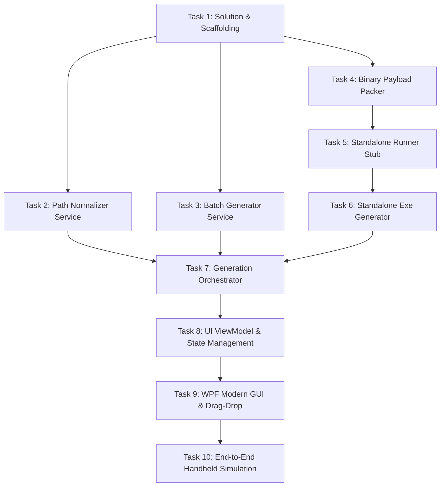

# Atomic Implementation Plan: FolderSC

**Project:** FolderSC (Folder Sync Companion)  
**Target Architecture:** C# / .NET 8 (WPF + Standalone Executable Stub)  
**Status:** Approved Plan  
**Reference PRD:** [.agents/prd.md](file:///C:/others/projects/foldersc/.agents/prd.md)  
**Reference Story:** [.agents/story.md](file:///C:/others/projects/foldersc/.agents/story.md)

---

## Plan Principles & Atomicity Rules
1. **Atomic:** Each task has a single responsibility, clear inputs/outputs, and an automated or deterministic verification test.
2. **Independent:** Each task defines clear interface contracts (`IPathNormalizer`, `IBatchGenerator`, `IExeGenerator`, `IPayloadPacker`). Tasks can be built and tested in isolation using mockable contracts.
3. **Incremental:** Every task produces a fully functional, buildable increment of the product.

---

## Dependency Graph



---

## Detailed Atomic Tasks

### Task 1: Solution & Project Scaffolding
- **Objective:** Create the .NET 8 multi-project solution structure adhering to clean architecture.
- **Projects Created:**
  - `src/FolderSC.Core`: Class Library (`net8.0-windows`) containing domain models, interfaces, and generators.
  - `src/FolderSC.Stub`: Minimal standalone executable (`net8.0-windows`) for the handheld runner.
  - `src/FolderSC.UI`: WPF Application (`net8.0-windows`) for the user-facing desktop app.
  - `tests/FolderSC.Tests`: xUnit Test Project (`net8.0-windows`) referencing `FolderSC.Core`.
- **Deliverables:**
  - `FolderSC.sln`
  - `.editorconfig` & Directory build properties.
- **Acceptance Criteria & Verification:**
  - Command `dotnet build FolderSC.sln` succeeds with 0 errors and 0 warnings.

---

### Task 2: Path Normalization Engine (`PathNormalizer`)
- **Objective:** Implement the core path normalization engine that detects user-specific directories and translates them into cross-device environment variables (`%LOCALAPPDATA%`, `%APPDATA%`, `%USERPROFILE%`, etc.).
- **Scope & Interface:**
  ```csharp
  public interface IPathNormalizer
  {
      NormalizedPathResult Normalize(string rawPath, bool useDynamicVariables = true);
  }
  ```
- **Rules to Support:**
  - `AppData\Local` $\rightarrow$ `%LOCALAPPDATA%`
  - `AppData\Roaming` $\rightarrow$ `%APPDATA%`
  - `Saved Games` $\rightarrow$ `%USERPROFILE%\Saved Games`
  - `Documents` $\rightarrow$ `%USERPROFILE%\Documents`
  - Arbitrary drive paths (e.g. `D:\Emulators\...`) preserved verbatim.
  - Slashes normalized to Windows backslashes (`\`).
- **Deliverables:**
  - `src/FolderSC.Core/Services/PathNormalizer.cs`
  - `src/FolderSC.Core/Models/NormalizedPathResult.cs`
  - `tests/FolderSC.Tests/PathNormalizerTests.cs`
- **Acceptance Criteria & Verification:**
  - `dotnet test --filter FullyQualifiedName~PathNormalizerTests` passes with 100% code coverage on all mapping rules and edge cases (trailing slashes, case-insensitivity, non-profile paths).

---

### Task 3: Batch Script Generator (`BatchGenerator`)
- **Objective:** Implement generation of standalone, transparent Windows Batch scripts (`.bat`).
- **Scope & Interface:**
  ```csharp
  public interface IBatchGenerator
  {
      string GenerateScriptContent(BatchGenerationOptions options);
      Task<string> WriteToFileAsync(string destinationFilePath, BatchGenerationOptions options);
  }
  ```
- **Script Requirements:**
  - Safe directory creation: `if not exist "<path>" mkdir "<path>"`.
  - Escaped quotes and spaces for complex folder paths.
  - Optional command to open File Explorer upon completion: `if "%OPEN_EXPLORER%"=="1" start "" explorer.exe "<path>"`.
  - Console feedback informing the user of the created path.
- **Deliverables:**
  - `src/FolderSC.Core/Services/BatchGenerator.cs`
  - `src/FolderSC.Core/Models/BatchGenerationOptions.cs`
  - `tests/FolderSC.Tests/BatchGeneratorTests.cs`
- **Acceptance Criteria & Verification:**
  - `dotnet test --filter FullyQualifiedName~BatchGeneratorTests` passes.
  - Generated test script executes in a sandboxed temporary directory via PowerShell and creates the exact expected directory structure without error.

---

### Task 4: Binary Payload Contract & Packer (`PayloadPacker`)
- **Objective:** Create a self-contained binary overlay serialization engine that packs and unpacks execution parameters for the `.exe` stub.
- **Format Specification:**
  - Header: Magic bytes `FSC1` (0x46, 0x53, 0x43, 0x31) (4 bytes).
  - Length: Big-endian or Little-endian 32-bit integer length of payload JSON (4 bytes).
  - Payload: UTF-8 encoded JSON containing:
    ```json
    {
      "targetPath": "%LOCALAPPDATA%\\GameName\\Saved",
      "openInExplorer": true,
      "title": "FolderSC Runner"
    }
    ```
- **Interface:**
  ```csharp
  public interface IPayloadPacker
  {
      byte[] Pack(RunnerPayload payload);
      RunnerPayload Unpack(byte[] binaryData);
  }
  ```
- **Deliverables:**
  - `src/FolderSC.Core/Services/PayloadPacker.cs`
  - `src/FolderSC.Core/Models/RunnerPayload.cs`
  - `tests/FolderSC.Tests/PayloadPackerTests.cs`
- **Acceptance Criteria & Verification:**
  - `dotnet test --filter FullyQualifiedName~PayloadPackerTests` passes round-trip tests, corrupt stream detection, and boundary tests.

---

### Task 5: Standalone Runner Stub (`FolderSC.Stub`)
- **Objective:** Create the standalone, lightweight runner executable (`FolderSC.Stub`) that executes on the handheld device (ROG Ally).
- **Execution Lifecycle:**
  1. Opens its own executable file on disk (`Environment.ProcessPath`).
  2. Reads overlay bytes from the end of the file past the PE boundaries to locate the `FSC1` magic marker.
  3. Deserializes `RunnerPayload`.
  4. Expands environment variables via `Environment.ExpandEnvironmentVariables(payload.TargetPath)`.
  5. Creates directory hierarchy: `Directory.CreateDirectory(expandedPath)`.
  6. If `payload.OpenInExplorer` is `true`, launches `Process.Start("explorer.exe", expandedPath)`.
  7. Displays a clean native Windows `MessageBox` confirming folder creation (or displays error if failed).
- **Deliverables:**
  - `src/FolderSC.Stub/Program.cs`
  - `src/FolderSC.Stub/FolderSC.Stub.csproj`
  - Embedded resource generation configuration or post-build copy step to make `FolderSC.Stub.exe` available to `FolderSC.Core`.
- **Acceptance Criteria & Verification:**
  - An integration test appends a dummy `RunnerPayload` to the built `FolderSC.Stub.exe`, runs it in a subprocess, and asserts:
    - Exit code is 0.
    - Expected directory is physically created on disk.

---

### Task 6: Executable Generator Service (`ExeGenerator`)
- **Objective:** Implement the service that takes a target path and options, loads the embedded runner stub binary, appends the packed payload, and outputs a ready-to-run `.exe`.
- **Interface:**
  ```csharp
  public interface IExeGenerator
  {
      Task<string> GenerateExeAsync(string destinationFilePath, ExeGenerationOptions options);
  }
  ```
- **Deliverables:**
  - `src/FolderSC.Core/Services/ExeGenerator.cs`
  - `src/FolderSC.Core/Models/ExeGenerationOptions.cs`
  - `tests/FolderSC.Tests/ExeGeneratorTests.cs`
- **Acceptance Criteria & Verification:**
  - `dotnet test --filter FullyQualifiedName~ExeGeneratorTests` passes.
  - The generated `.exe` file size is valid, has valid PE signatures, and unpacks the exact payload specified.

---

### Task 7: Core Generation Orchestrator (`GenerationOrchestrator`)
- **Objective:** Create the unifying service that coordinates path normalization, default filename deduction, output directory resolution, and routing to the requested generator (`.bat` vs `.exe`).
- **Interface:**
  ```csharp
  public interface IGenerationOrchestrator
  {
      Task<GenerationResult> ProcessAsync(GenerationRequest request);
  }
  ```
- **Behavior:**
  - Infers default output filename from leaf folder: `C:\...\MyGame\Saved` $\rightarrow$ `Create_Saved_Folder.exe` (or `.bat`).
  - Sets default output folder to User Desktop if unspecified.
  - Returns `GenerationResult` with `Success`, `OutputFilePath`, `NormalizedPath`, and `ErrorMessage`.
- **Deliverables:**
  - `src/FolderSC.Core/Services/GenerationOrchestrator.cs`
  - `src/FolderSC.Core/Models/GenerationRequest.cs`
  - `src/FolderSC.Core/Models/GenerationResult.cs`
  - `tests/FolderSC.Tests/GenerationOrchestratorTests.cs`
- **Acceptance Criteria & Verification:**
  - `dotnet test --filter FullyQualifiedName~GenerationOrchestratorTests` passes for both `.bat` and `.exe` pathways with mocked and real generators.

---

### Task 8: UI ViewModel & State Management (`MainViewModel`)
- **Objective:** Implement the MVVM ViewModel managing all UI state, validation, commands, and reactive path updates.
- **Key Properties & Commands:**
  - `SourcePath`: Auto-triggers `PathNormalizer` and populates `NormalizedPreviewPath` and `SuggestedFilename`.
  - `SelectedFormat`: Enum (`Batch` or `Executable`).
  - `UseDynamicVariables`: Checkbox toggle (default `true`).
  - `OpenExplorerOnExecution`: Checkbox toggle (default `true`).
  - `OutputDirectory`: Path string (default `Desktop`).
  - `ProcessCommand`: Asynchronous command executing `IGenerationOrchestrator.ProcessAsync`.
  - `OpenOutputFolderCommand`: Opens Windows Explorer at the generated file.
- **Deliverables:**
  - `src/FolderSC.UI/ViewModels/MainViewModel.cs`
  - `src/FolderSC.UI/ViewModels/ViewModelBase.cs`
  - `tests/FolderSC.Tests/MainViewModelTests.cs`
- **Acceptance Criteria & Verification:**
  - `dotnet test --filter FullyQualifiedName~MainViewModelTests` validates all reactive property updates, command executions, and error state transitions.

---

### Task 9: Modern Windows WPF View (`MainWindow.xaml`)
- **Objective:** Build the modern, responsive, DPI-aware user interface.
- **Features:**
  - Modern Windows 11 style (dark/light theme support, rounded controls, clean margins).
  - Source path entry with "Browse Folder..." dialog (`CommonOpenFileDialog` or standard folder picker).
  - Drag & Drop zone: Dragging any folder from Explorer onto the window populates `SourcePath`.
  - Real-time preview card displaying the translated target path with dynamic variables highlighted.
  - Format toggle buttons / segmented control (`.exe` vs `.bat`).
  - Output folder picker with "Desktop" default.
  - Prominent "Process / Generate" button with loading state.
  - Success banner with "Open File Location" button.
- **Deliverables:**
  - `src/FolderSC.UI/MainWindow.xaml`
  - `src/FolderSC.UI/MainWindow.xaml.cs`
  - `src/FolderSC.UI/App.xaml`
  - Theme styling resources.
- **Acceptance Criteria & Verification:**
  - `dotnet build` succeeds.
  - Launching the app displays the window correctly scaled, responds to folder picking, drag-and-drop, and triggers generation cleanly.

---

### Task 10: End-to-End Handheld Simulation & Verification
- **Objective:** Full end-to-end integration test simulating the cross-device sync workflow.
- **Test Scenario:**
  1. Generate both a `.bat` and a `.exe` pointing to `%LOCALAPPDATA%\TestGame\SaveData`.
  2. Simulate running them in an isolated test environment (or subprocess with altered environment variables simulating a different username).
  3. Verify that directory `TestGame\SaveData` is created under the active test `%LOCALAPPDATA%`.
  4. Verify that running the script twice does not produce errors or corrupt existing files (idempotency).
- **Deliverables:**
  - `tests/FolderSC.Tests/EndToEndWorkflowTests.cs`
- **Acceptance Criteria & Verification:**
  - `dotnet test` runs the complete test suite with 100% pass rate.
