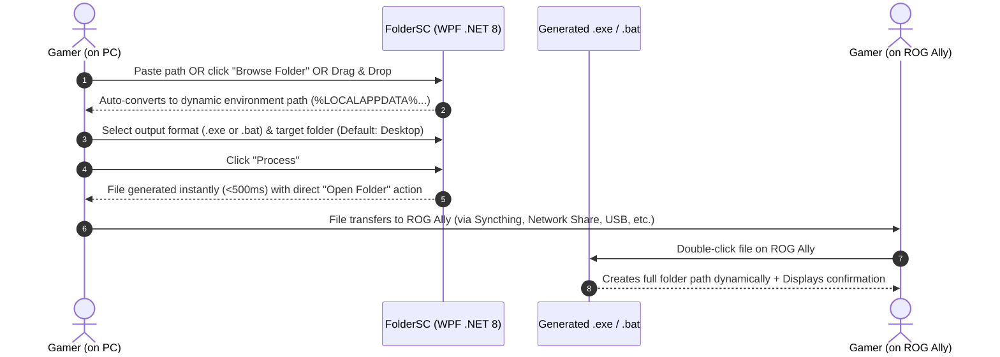

# Product Requirements Document (PRD)

**Project Name:** FolderSC (Folder Sync Companion)  
**Version:** 1.0.0  
**Status:** Approved / Ready for Implementation  
**Author:** Antigravity AI  
**Created:** 2026-10-18  
**Reference:** [.agents/story.md](file:///C:/others/projects/foldersc/.agents/story.md)

---

## 1. Executive Summary

**FolderSC** is a lightweight Windows desktop utility designed for cross-device gamers who sync game saves manually or via tools like Syncthing between a primary desktop PC and a Windows handheld gaming device (e.g., ASUS ROG Ally, Lenovo Legion Go, MSI Claw).

While file synchronization tools (like Syncthing) automatically keep files in sync once configured, setting up new game saves on handheld devices remains frustrating. Users must replicate deeply nested, complex directory paths (such as `%LOCALAPPDATA%\GameName\Saved\SaveGames`) using touchscreens or awkward on-screen controls. 

FolderSC solves this by allowing users on their main PC to pick or input a save folder path and instantly generate a portable, one-click script or executable (`.exe` / `.bat`) targeting their handheld. When run on the handheld device, it immediately creates the required folder structure with zero typing.

---

## 2. Problem Statement & User Personas

### 2.1 The Problem
- **Tedious On-Screen Navigation:** Windows handhelds (ROG Ally, ROG Ally X, Legion Go) have small touchscreens and gamepad-driven inputs. Typing long paths or navigating through hidden folders (`AppData`, `Saved Games`, `Documents`) in File Explorer is slow, error-prone, and frustrating.
- **Save Game Dispersal:** Games without Steam Cloud or platform cloud sync store save files across a wide variety of directories (`%LOCALAPPDATA%`, `%APPDATA%`, `%USERPROFILE%\Documents\My Games`, `%USERPROFILE%\Saved Games`, root drive custom folders).
- **Username Mismatch:** Windows usernames between a desktop PC (e.g., `C:\Users\John\...`) and an ROG Ally (e.g., `C:\Users\asus\...`) are frequently different. Simply copying a hardcoded path will fail or create unwanted folder trees.
- **Syncthing Pre-requisite:** Syncthing requires the destination directory to exist or be mapped cleanly to avoid sync errors and conflict folders.

### 2.2 Target Persona
- **Persona:** Handheld & Desktop PC Gamer ("Alex")
- **Hardware:** High-end Windows 11 Gaming Desktop + ASUS ROG Ally (Windows 11).
- **Tooling:** Uses Syncthing to sync save games across devices for non-cloud-enabled games (emulators, indie games, GOG/itch.io titles, offline RPGs).
- **Goal:** Play a game on PC, effortlessly replicate the save folder location on the ROG Ally, run Syncthing, and continue playing on the go.

---

## 3. Product Vision & Goals

### 3.1 Vision
A zero-friction, single-click companion utility that bridges the gap between PC and handheld file folder setups.

### 3.2 Key Objectives
- **Simplicity:** Provide a minimal, clean interface where generating a setup script takes less than 5 seconds.
- **Handheld-Aware Path Resolution:** Automatically abstract and translate user-specific directories into standard Windows environment variables (`%USERPROFILE%`, `%LOCALAPPDATA%`, `%APPDATA%`) so scripts work across machines regardless of Windows username differences.
- **Dual Output Support:** Provide toggleable generation for both standalone `.exe` (for clean GUI dialog execution) and lightweight `.bat` batch scripts (for maximum transparency and portability).

---

## 4. Key User Journeys

---

## 5. Functional Requirements

### 5.1 Input & Path Handling (PC)
- **FR-1.1 Manual Path Input:** Text input field allowing users to paste or type any absolute or relative Windows folder path.
- **FR-1.2 Folder Picker Dialog:** A standard Windows folder browser dialog button allowing users to browse and pick a directory visually.
- **FR-1.3 Drag & Drop Support:** Users can drag a folder directly from Windows File Explorer into the FolderSC window to populate the path.
- **FR-1.4 Intelligent Path Normalization (Automatic Conversion):**
  - The app automatically detects and converts user profile locations:
    - `C:\Users\<Current>\AppData\Local\...` $\rightarrow$ `%LOCALAPPDATA%\...`
    - `C:\Users\<Current>\AppData\Roaming\...` $\rightarrow$ `%APPDATA%\...`
    - `C:\Users\<Current>\Saved Games\...` $\rightarrow$ `%USERPROFILE%\Saved Games\...`
    - `C:\Users\<Current>\Documents\...` $\rightarrow$ `%USERPROFILE%\Documents\...`
  - The app displays both the **Source Path** (as selected on PC) and the **Target Pattern** (what will be created on the destination device).
  - Users can toggle between *Dynamic Environment Path* (enabled by default) and *Literal Absolute Path*.

### 5.2 Output & Generation Engine
- **FR-2.1 Output Destination:**
  - Defaults to the user's Desktop (`%USERPROFILE%\Desktop`).
  - Option to browse and pick a custom output directory.
- **FR-2.2 Output Format Selection (Toggleable):**
  - **Option A: Standalone Executable (`.exe`):**
    - Built via precompiled lightweight stub runner with embedded binary overlay/metadata.
    - Zero compiler dependencies on the user's machine.
    - Silent folder creation + Clean Windows MessageBox alert on success (e.g., *"Successfully created folder: `<path>`"*).
  - **Option B: Windows Batch Script (`.bat`):**
    - Pure Windows CMD script utilizing `if not exist "<path>" mkdir "<path>"`.
    - Outputs visual status in command prompt, pauses briefly or displays Windows notification, and exits.
- **FR-2.3 Execution Customizations:**
  - **Open in Explorer:** Checkbox option in FolderSC (default: checked) to cause the generated `.exe`/`.bat` to open File Explorer at the created directory after creation.
  - **Custom Output Filename:** Defaults to `Create_<TargetFolderName>_Folder.exe` (or `.bat`), editable before generation.

### 5.3 User Interface & Feedback
- **FR-3.1 Modern GUI:** Built with C# / .NET 8 WPF with modern dark/light theme matching Windows 11 Fluent style.
- **FR-3.2 One-Click "Process" Button:** Prominent, instant action.
- **FR-3.3 Completion State:** Shows immediate toast/banner with "Open in Explorer" and "Copy Path" buttons.

---

## 6. Non-Functional Requirements

### 6.1 Usability & UX
- Minimalist, single-window UI requiring zero configuration to use out of the box.
- DPI-aware scaling for crisp rendering on 1080p handheld displays and 4K desktop screens.

### 6.2 Portability & Performance
- **Framework:** C# / .NET 8 (WPF).
- **Execution Speed:** File generation occurs in $< 100\text{ ms}$.
- **Standalone Delivery:** FolderSC can be published as a self-contained, single-file Windows executable.
- **Target File Footprint:** Generated `.bat` is $< 1\text{ KB}$; generated `.exe` is tiny and standalone with 0 dependencies on the target ROG Ally.

### 6.3 Safety & Security
- Pure folder creation only; will never delete, move, or overwrite existing files.
- Handles spaces and special characters safely in paths with proper escaping and quotes.

---

## 7. Technical Architecture & Implementation Details

### 7.1 Tech Stack
- **Application Framework:** C# / .NET 8 (`net8.0-windows`) WPF Application.
- **UI Architecture:** MVVM (Model-View-ViewModel) pattern with `CommunityToolkit.Mvvm` or clean standard C# bindings.
- **Output Generator:**
  - **Batch Generator:** Formatted template generator escaping quotes and expanding `%` tokens correctly.
  - **Exe Generator:** Precompiled standalone Win32 binary runner template embedded as an assembly resource (`StubRunner.bin`). At generation time, FolderSC writes the stub binary and appends the JSON configuration payload (path, openExplorer flag, title) to the binary overlay. The stub reads its own overlay at runtime, expands environment variables via Win32 `ExpandEnvironmentStringsW`, creates the directory, optionally opens `explorer.exe`, and displays a native Win32 `MessageBoxW`.

### 7.2 Directory Translation Mapping Matrix

| Source Path Pattern (on PC) | Environment Variable Mapping |
| :--- | :--- |
| `C:\Users\<User>\AppData\Local\...` | `%LOCALAPPDATA%\...` |
| `C:\Users\<User>\AppData\Roaming\...` | `%APPDATA%\...` |
| `C:\Users\<User>\Saved Games\...` | `%USERPROFILE%\Saved Games\...` |
| `C:\Users\<User>\Documents\...` | `%USERPROFILE%\Documents\...` |
| `C:\Users\<User>\Videos\...` | `%USERPROFILE%\Videos\...` |
| Custom / Alternate Drives (`D:\...`) | Verbatim drive letter (with optional prompt if drive letter might differ) |

---

## 8. Development Tasks & Delivery Plan

1. **Phase 1: Project Setup & Core Logic**
   - Initialize .NET 8 WPF solution (`FolderSC.sln`).
   - Implement `PathNormalizer` service (unit tested with various Windows paths).
   - Implement `BatchScriptGenerator` service.
2. **Phase 2: Executable Stub & Exe Generator**
   - Implement lightweight standalone stub runner.
   - Implement `ExeScriptGenerator` embedding the stub and overlay payload.
3. **Phase 3: GUI & Integration**
   - Design modern WPF interface with drag-and-drop, path preview, output toggle (`.exe` vs `.bat`), and browse dialogs.
   - Wire up ViewModel and generation pipeline.
   - Test end-to-end generation and verification on target simulated paths.
